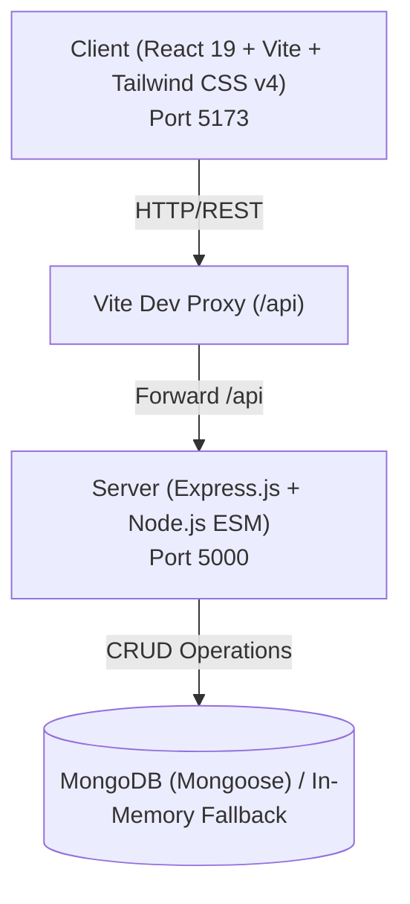

# 🚀 AURUMFLOW — Predictive Cash Flow Management & Smart Voice Ledger for SMBs

A modern, production-grade **MERN** (MongoDB, Express.js, React 19, Node.js) full-stack application featuring **Predictive Cash Runway Analytics**, **eKhata Smart Voice Ledger with Groq AI**, and **Tailwind CSS v4**.

---

## 🏗️ Architecture Overview



---

## 📁 Directory Structure

```plaintext
Zenniths_Srujana/
├── package.json              # Root package with concurrent dev scripts
├── .gitignore                # Comprehensive multi-tier git ignore
├── README.md                 # Project documentation
│
├── client/                   # React Frontend
│   ├── index.html            # HTML entry point with Google Fonts
│   ├── package.json          # Frontend dependencies
│   ├── vite.config.js        # Vite config with @tailwindcss/vite & API proxy
│   └── src/
│       ├── main.jsx          # React DOM render entry
│       ├── App.jsx           # Main Dashboard with CRUD, live metrics & API console
│       ├── index.css         # Tailwind CSS v4 (@import "tailwindcss") & design tokens
│       ├── components/
│       │   ├── Navbar.jsx           # Top navigation with live backend & DB badges
│       │   ├── ItemCard.jsx         # Resource card with tag, edit & delete actions
│       │   ├── ItemModal.jsx        # Create/Update resource modal dialog
│       │   ├── StatusBadge.jsx      # Semantic status, category & priority badges
│       │   ├── ArchitectureCard.jsx # Interactive architectural folder viewer
│       │   └── ApiConsole.jsx       # In-browser REST API tester
│       └── services/
│           └── api.js        # Centralized fetch client for /api/v1 endpoints
│
└── server/                   # Express Backend
    ├── package.json          # Backend dependencies (ES Modules: "type": "module")
    ├── .env                  # Environment variables
    ├── .env.example          # Environment variables template
    └── src/
        ├── server.js         # HTTP server bootstrap & graceful shutdown listeners
        ├── app.js            # Express application with Helmet, CORS, Morgan
        ├── config/
        │   └── db.js         # Mongoose connection with fallback detection
        ├── controllers/
        │   ├── health.controller.js # Health metrics (uptime, memory, DB status)
        │   └── item.controller.js   # Full CRUD operations + in-memory store
        ├── models/
        │   └── item.model.js        # Mongoose Schema & validation
        ├── middleware/
        │   └── errorHandler.js      # 404 handler and global error formatter
        └── routes/
            ├── index.js             # Central /api/v1 route registry
            ├── health.routes.js     # Health route endpoint
            └── item.routes.js       # Resource CRUD route endpoints
```

---

## ⚡ Quick Start

### 1. Prerequisites
- **Node.js**: v18.0.0 or higher (v24.x tested)
- **npm**: v9.0.0 or higher
- **MongoDB** *(Optional)*: Local MongoDB or MongoDB Atlas URI (app runs with an in-memory fallback store if MongoDB is not running locally).

### 2. Install Dependencies
Run the install command from the root directory:
```bash
npm run install:all
```
*(or run `npm install` inside both `client` and `server` folders)*

### 3. Configure Environment Variables
A default `.env` is created in `server/.env`:
```env
PORT=5000
NODE_ENV=development
MONGO_URI=mongodb://127.0.0.1:27017/mern_starter
CLIENT_URL=http://localhost:5173
```

### 4. Start the Application
Run both the frontend and backend concurrently with a single command:
```bash
npm run dev
```

- **Frontend Client**: [http://localhost:5173](http://localhost:5173)
- **Backend API**: [http://localhost:5000](http://localhost:5000)
- **Health Check**: [http://localhost:5000/api/v1/health](http://localhost:5000/api/v1/health)

---

## 📜 Available NPM Scripts

| Command | Location | Description |
|---|---|---|
| `npm run dev` | Root | Runs both `server` (port 5000) and `client` (port 5173) concurrently |
| `npm run dev:client` | Root | Starts only the React + Vite frontend |
| `npm run dev:server` | Root | Starts only the Node + Express backend with `--watch` |
| `npm run build` | Root | Builds the client production bundle into `client/dist` |
| `npm run install:all` | Root | Installs dependencies across root, client, and server |

---

## 📡 REST API Reference

All backend routes are prefixed with `/api/v1`:

| Method | Endpoint | Description |
|---|---|---|
| `GET` | `/` | API status & endpoint discovery |
| `GET` | `/api/v1/health` | System health, memory, uptime, and DB state |
| `GET` | `/api/v1/items` | List items (supports `?category=`, `?status=`, `?search=`) |
| `GET` | `/api/v1/items/:id` | Get item by ID |
| `POST` | `/api/v1/items` | Create new item (`title`, `description`, `category`, etc.) |
| `PUT` | `/api/v1/items/:id` | Update item |
| `DELETE` | `/api/v1/items/:id` | Delete item |

---

## 🎨 Styling with Tailwind CSS v4

The project uses `@tailwindcss/vite` without legacy JavaScript config files:
- Defined in `client/src/index.css` via `@import "tailwindcss";`
- Includes customized dark theme palettes, glassmorphic card utilities, and Outfit / Plus Jakarta Sans fonts.
